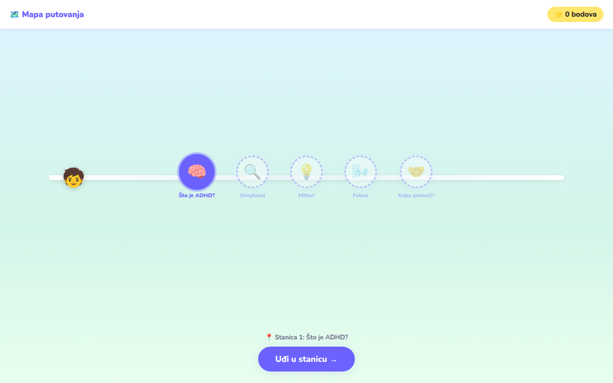
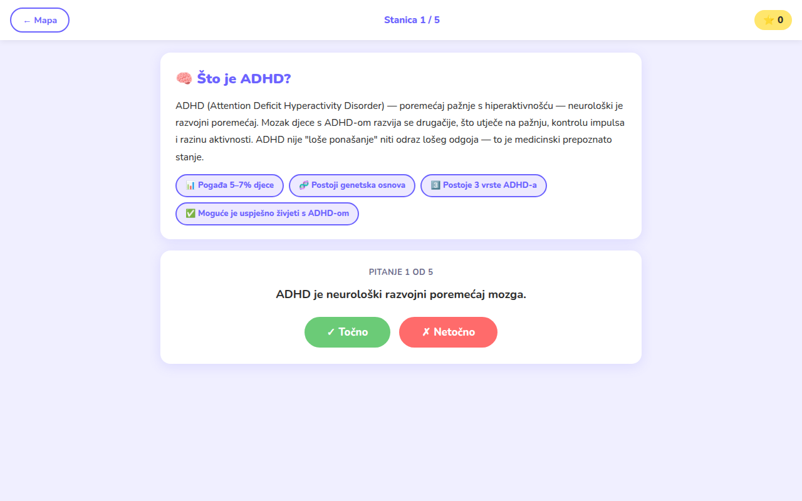
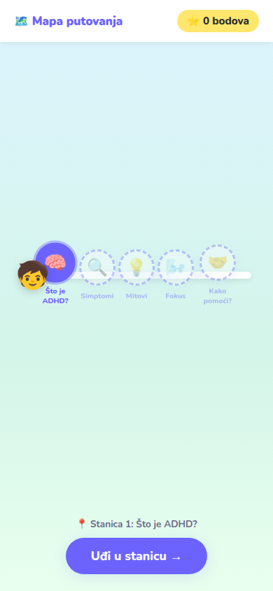

# ADHD Quest 🧠

**An educational web game that teaches children what ADHD is — built for the Vista ADHD Centre.**

### ▶ [Play it in your browser](https://ivanposel.github.io/adhd-quest/)

Children with ADHD are often told they are "lazy". The centre asked for something a ten-year-old could play with a
parent or teacher: short, interactive, never judgmental, in Croatian, free, and working in any browser with nothing
to install. ADHD Quest is a journey across five short stations:

| Station | What the child does |
|---|---|
| 🧠 What is ADHD? | reads one short card, then a five-question true / false quiz with instant feedback |
| 🔍 Symptoms | sorts nine symptoms into inattention / hyperactivity / impulsivity by drag and drop |
| 💡 Myths | decides "myth or fact" for each card and learns why |
| 🌬️ Focus | a guided 4-7-8 breathing exercise with an animated circle |
| 🤝 How to help | picks the most helpful response in three everyday situations |

## Design decisions

- **Designed from the client's brief and a persona** (Lucija, 10, with ADHD): short texts, one task per screen,
  progress always visible, stations unlocked in order so the child is never lost.
- **No backend, no tracking.** Everything runs in the browser; scores live only in memory. Children's data is never
  collected, and there is no server to pay for.
- **Works offline.** Sound effects are synthesised with the **Web Audio API** instead of audio files, illustrations are
  emoji and CSS, so the whole game is four small files and loads instantly.
- **Responsive**: playable on a phone, a tablet or a classroom screen.

**Stack:** HTML5 · CSS3 (animation, gradients) · vanilla JavaScript (ES6) · Web Audio API

Made by Ivan Posel for the course *Building Multimedia Systems*, Polytechnic of Rijeka, 2026.

---

## Hrvatski

Edukativna web igra o ADHD-u za djecu, izrađena za **Vista ADHD centar** u sklopu kolegija *Izgradnja multimedijskih sustava*.

Kroz pet kratkih interaktivnih stanica djeca (uz roditelje i pedagoge) uče što je ADHD, prepoznaju simptome, razbijaju mitove, vježbaju fokus i otkrivaju kako pomoći.

## Stanice
1. 🧠 **Što je ADHD?** — kviz Točno/Netočno
2. 🔍 **Simptomi** — razvrstavanje povlačenjem (drag & drop)
3. 💡 **Mitovi** — mit ili činjenica
4. 🌬️ **Fokus** — vježba disanja 4-7-8
5. 🤝 **Kako pomoći?** — scenariji iz svakodnevice

## Pokretanje
Otvori `index.html` u web pregledniku. Internet nije potreban — aplikacija je u potpunosti statična.

## Tehnologije
HTML5, CSS3, JavaScript (vanilla), Web Audio API, Google Fonts (Nunito).

## Struktura
| Datoteka | Opis |
|----------|------|
| `index.html` | Struktura ekrana (početni, mapa, stanica, završni) |
| `style.css` | Izgled, responzivnost i animacije |
| `content.js` | Sav edukativni sadržaj (pitanja, simptomi, mitovi, scenariji) |
| `game.js` | Logika igre, stanje, bodovanje i interakcije |
